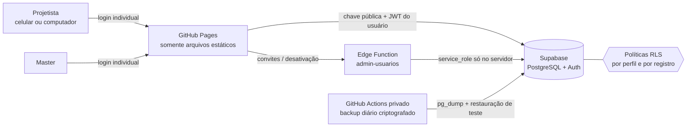

# Engefril · Sistema web de gestão de TPEs

Aplicação web que substitui a planilha **TAREF_PROJ_ENGEFRIL_VER_035.xlsx** como ferramenta de trabalho da engenharia de projetos. Ela tem duas áreas:

- **Projetista.** Consulta as próprias tarefas na sequência prevista e registra os apontamentos de horas.
- **Administrador Master.** Planeja e atribui tarefas, acompanha indicadores, explora a Central de Dados, importa planilhas antigas, exporta Excel, audita cálculos e confere backups.



## O que está pronto e testado

| Área | Situação | Evidência |
|---|---|---|
| Banco, RLS e auditoria | Implementado | `tests/db/acesso.test.ts`: 16 testes de acesso cruzado executados em PostgreSQL real |
| Cálculo de horas e custos (regra da VER_035) | Implementado em SQL e em TypeScript | `tests/db/equivalencia.test.ts`: os 442 lançamentos da VER_035 batem com o Excel nas duas implementações |
| Indicadores (aba KPI) | Implementado | Mesmo teste. Diferenças só nas correções documentadas em `docs/VALIDACAO.md` |
| Importação com prévia, duplicidade e reversão | Implementado | Mesmo teste: prévia sem gravação, reimportação = 442 duplicados, reversão exata |
| Backup e restauração | Procedimento implementado | `tests/db/backup.test.ts`: pg_dump, banco novo e verificação de integridade (dados fictícios) |
| Telas do projetista e do Master | Implementado | Build de produção + teste visual com back-end simulado (`tests/ui/smoke.py`) |
| Edge Function de usuários | Implementada | Tipos verificados com `deno check`. **Não executada contra um Supabase real** |
| Workflow de backup no GitHub | Modelo pronto | **Não executado** (precisa do seu Supabase e de um repositório privado) |

## Começar

1. Siga **[docs/PUBLICACAO.md](docs/PUBLICACAO.md)**, o roteiro passo a passo: Supabase, GitHub Pages, primeiro Master, convites e importação.
2. Manuais: **[docs/MANUAL_ADMIN.md](docs/MANUAL_ADMIN.md)** e **[docs/GUIA_PROJETISTA.md](docs/GUIA_PROJETISTA.md)**.
3. Segurança e LGPD: **[docs/SEGURANCA.md](docs/SEGURANCA.md)**. Backup: **[docs/BACKUP.md](docs/BACKUP.md)**.
4. Testes e pendências: **[docs/MATRIZ_TESTES.md](docs/MATRIZ_TESTES.md)**. Cálculos: **[docs/VALIDACAO.md](docs/VALIDACAO.md)**.

```bash
npm ci
cp .env.example .env.local      # preencha URL e chave PÚBLICA do Supabase
npm run dev                     # http://localhost:5173
npm test                        # testes de segurança, cálculo e backup
```

## Regras de ouro do repositório

- **Nunca** versione a planilha original, exportações, backups, `.env.local` ou a chave `service_role`. O `.gitignore` já bloqueia esses arquivos.
- O workflow de publicação falha se encontrar chave secreta ou arquivo de dados no build.
- Dados reais só entram pela tela **Importar planilha**, já no Supabase de produção.

## Estrutura

```
src/                     front-end React + TypeScript (Vite)
  lib/calculo.ts         motor de cálculo (mesma regra da view SQL)
  lib/importador.ts      leitura de planilhas legadas no navegador
  pages/projetista/      Início, Minhas tarefas, Registrar atividade, Meus apontamentos
  pages/master/          Painel, Indicadores, Central de Dados, TPEs, Sequência, O.S.,
                         Apontamentos, Importar, Exportar, Integridade, Usuários, Parâmetros, Auditoria
supabase/migrations/     esquema, RLS, importação, referências e endurecimento (aplicar em ordem)
supabase/functions/      Edge Function admin-usuarios (convites/desativação)
supabase/verificar_integridade.sql   verificação pós-restauração
tests/                   db (PGlite), calc (unitários), ui (smoke visual)
scripts/                 backup local verificado, gerador de fixture privada
```
